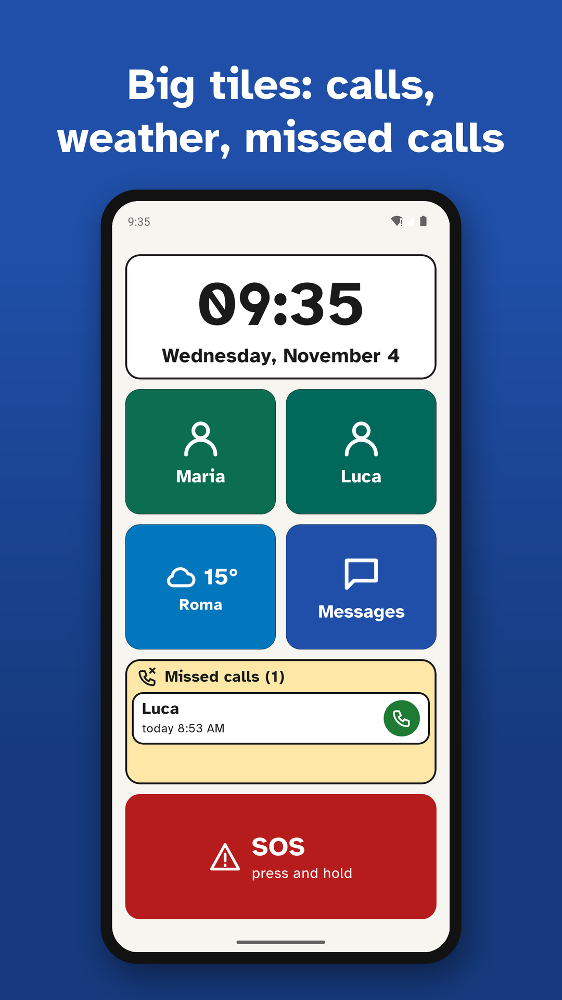
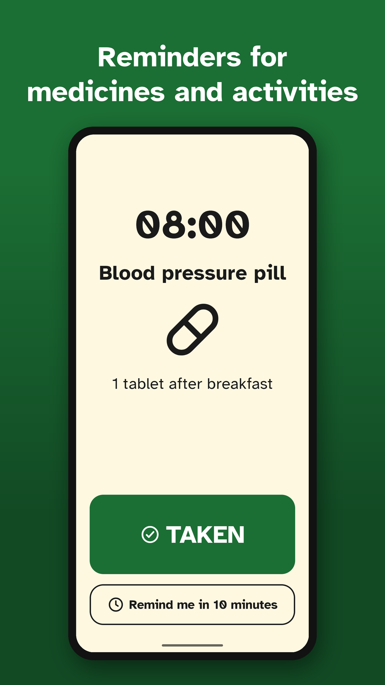
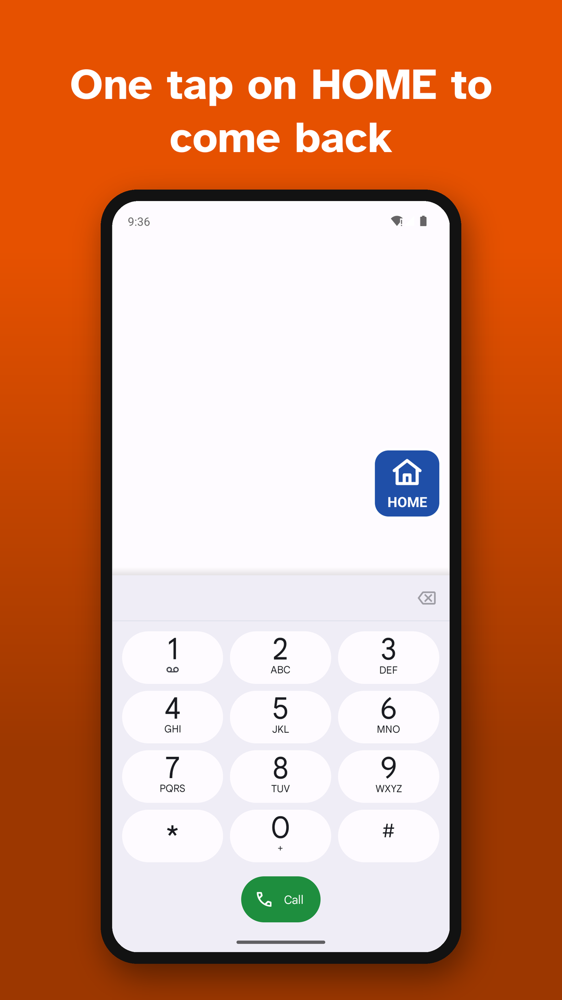
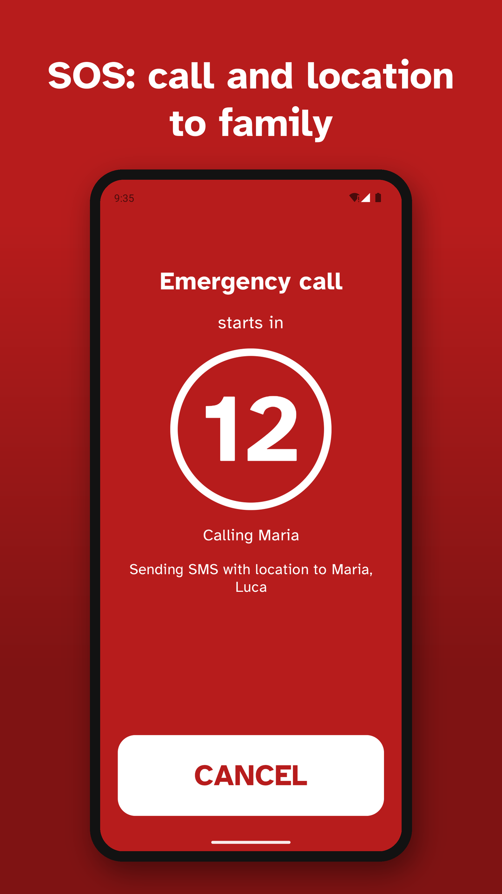
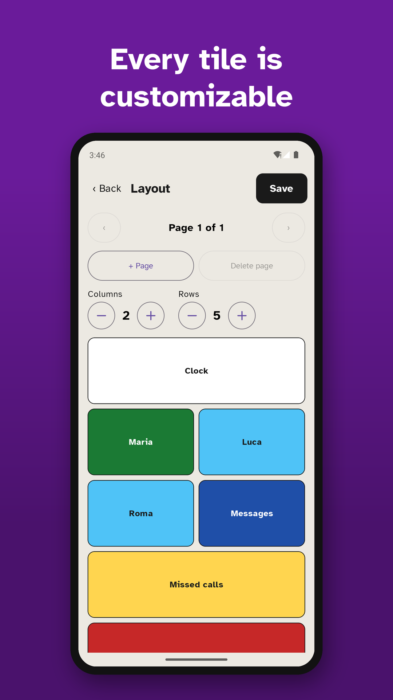
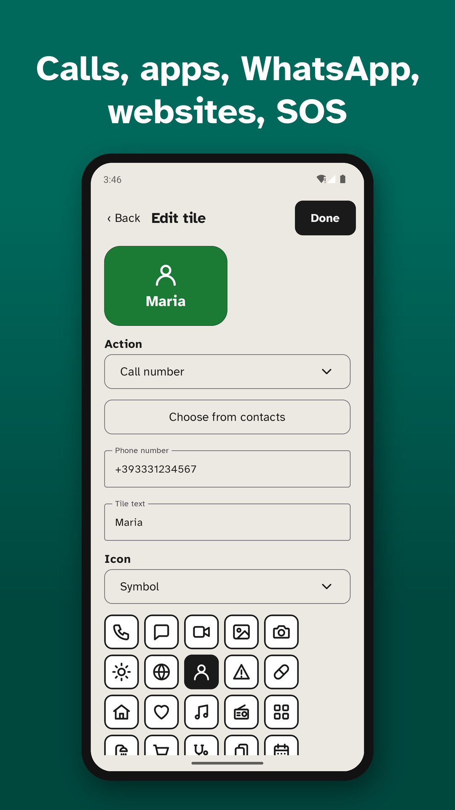
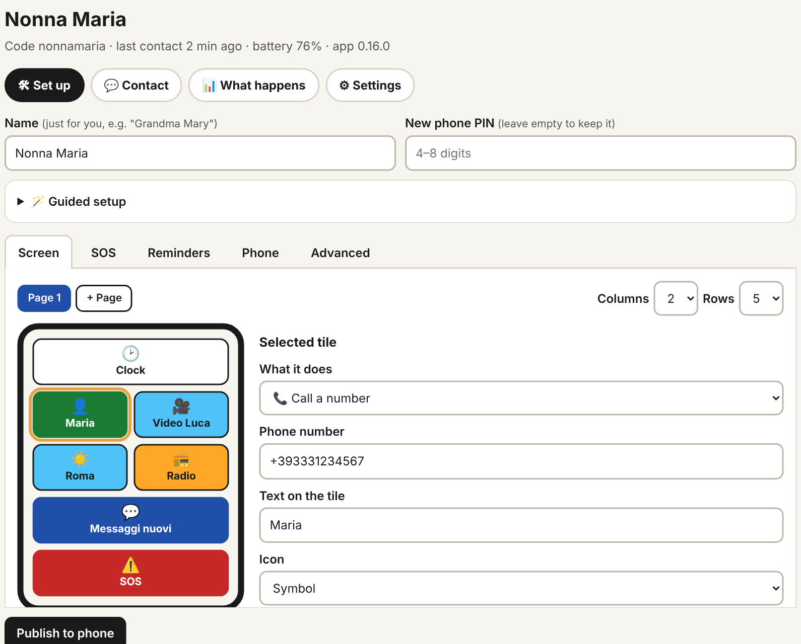

# SemplicePhone

**The simple phone for grandparents.** An Android launcher with a few big tiles, SOS, reminders
and a web page where the family sets everything up from afar. Free, no ads, free software.

[](../../releases/latest)
[](../../actions/workflows/build.yml)
[](LICENSE)


*[Versione italiana](README.md)*

<p align="center">
  
  
  
</p>

**[⬇ Download the APK](../../releases/latest/download/SemplicePhone.apk)** · [How to install](#download-and-install) · [Family portal](#for-the-family-the-portal) · [Privacy](PRIVACY.md)

## For the person using it

- **A few big, clear tiles.** Each tile does one thing: call Maria, open WhatsApp, send an SMS,
  open a website. Large text, strong colours and a highly legible font.
- **SOS.** Just hold it: a cancellable countdown starts, then a call to the first family member
  and an SMS with the location to everyone.
- **Reminders for medicines and activities** (medicine, shower, shopping, appointments, card
  games…): full-screen alarm even on the lock screen, with a photo of the pill. It rings until
  someone presses "TAKEN" or "DONE".
- **Missed calls.** The tile shows who called and was not called back: tap the name to call back.
- **No getting lost.** A "HOME" button stays visible inside other apps: one tap and you are back.
  Apps open on their first screen, not on the last page left half-way.
- **Search apps.** A tile opens search inside the launcher: type or say part of the name (even
  the initials, "gm" for Google Maps) and one tap opens the app.
- **Voice.** A long press reads a tile aloud, or the time on the clock. Before calling, the phone
  says "Calling Maria".
- **Weather, family photos and a bedside clock** while charging.
- **Safer calls.** Unknown numbers can be blocked: only contacts and family get through.
  Automatic speakerphone.

<p align="center">
  
  
  
</p>

## For the family: the portal

A single PHP file for your own web space ([`tools/remote-server`](tools/remote-server)). From
there you set up tiles, SOS and reminders with a visual editor and publish them to the phone.
Changes are signed: the phone only accepts those from its own portal.

<p align="center"></p>

- **Alerts** on Telegram or email: SOS with location, unconfirmed reminder, low battery, phone
  out of contact, blocked calls.
- **"Where is it?"**: phone location on request, only if allowed on the phone.
- **Weekly summary** every Monday and a "Last 7 days" card for each phone.
- **It also sees changes made on the phone** (photos included) and flags missing permissions.
- **Version history**, copy a configuration from one phone to another.

Settings can also be changed on the phone: tap the clock 5 times and enter the PIN.

## Download and install

| Edition | Download | Install |
|---|---|---|
| **Standard** | [SemplicePhone.apk](../../releases/latest/download/SemplicePhone.apk) | from the phone's browser |
| **Full** (unread badges, `#UPDATE` SMS command, silent updates) | [SemplicePhone-completo.apk](../../releases/latest/download/SemplicePhone-completo.apk) | with ADB |

1. Open the APK link on the phone and allow the browser to install apps.
2. If Play Protect says *"Harmful app blocked"*, it is a false positive caused by the SOS
   permissions (SMS, location, calls): choose *Install anyway*. The source code is right here.
3. Open SemplicePhone and make it the Home app.
4. Tap the clock **5 times**, choose a PIN, set up tiles, SOS numbers and reminders, then **Save**.

If Android says *"For your security, this setting is currently unavailable"*, open App info › ⋮ ›
*Allow restricted settings*, or run `adb shell appops set app.semplicephone ACCESS_RESTRICTED_SETTINGS allow`.

All editions share the package name and signing key: install one over another without losing
settings. Google Play and F-Droid builds are prepared ([`tools/play`](tools/play),
[`tools/fdroid`](tools/fdroid)).

Optional: `adb shell dpm set-device-owner app.semplicephone/.admin.AdminReceiver` on a freshly
reset phone locks the notification shade, blocks installs and factory reset, grants permissions
automatically and enables silent updates (full edition).

## Languages and privacy

- App and portal in English, Italian, German, French and Spanish. The app follows the phone's
  language; Android 13+ can set one just for SemplicePhone. To translate: [TRANSLATING.md](TRANSLATING.md).
- No account, no analytics, no data to the developer. With remote management, data only goes to
  the family's own portal: [PRIVACY.md](PRIVACY.md) (in Italian).

## For developers

Kotlin + Jetpack Compose, minSdk 29 / targetSdk 36, Atkinson Hyperlegible font (OFL). Build and
release instructions, tile model and milestones are in the [Italian README](README.md#per-sviluppatori);
the release checklist is [RELEASING.md](RELEASING.md).

```
./gradlew assembleStandardDebug testStandardDebugUnitTest
```

## License

Free software, Copyright (C) 2026 Francesco Sorzini. App: [GPL-3.0-or-later](LICENSE); portal:
[AGPL-3.0-or-later](tools/remote-server/LICENSE). See [`NOTICE.md`](NOTICE.md). The SOS button
contacts the numbers you set: it does not replace emergency services.
