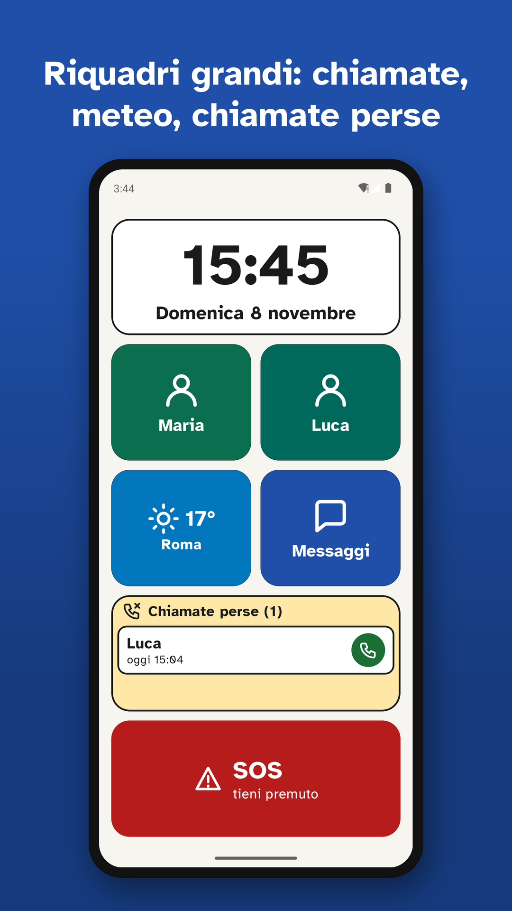
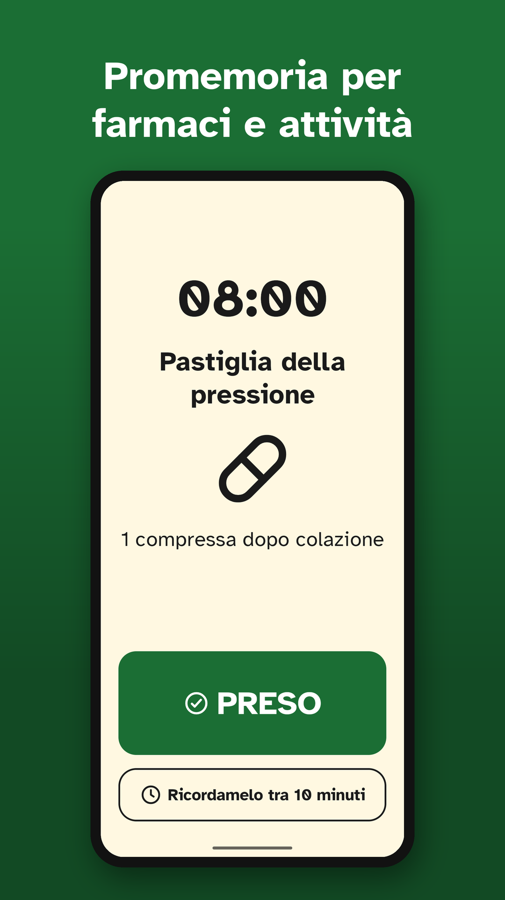
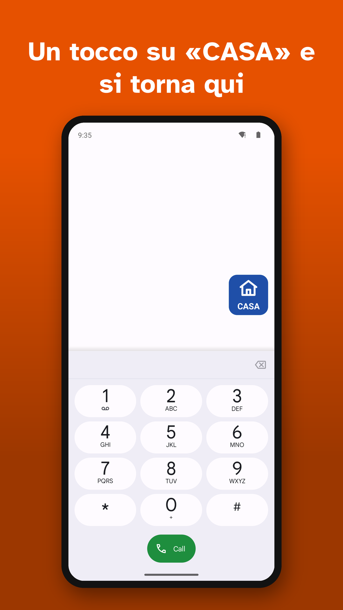
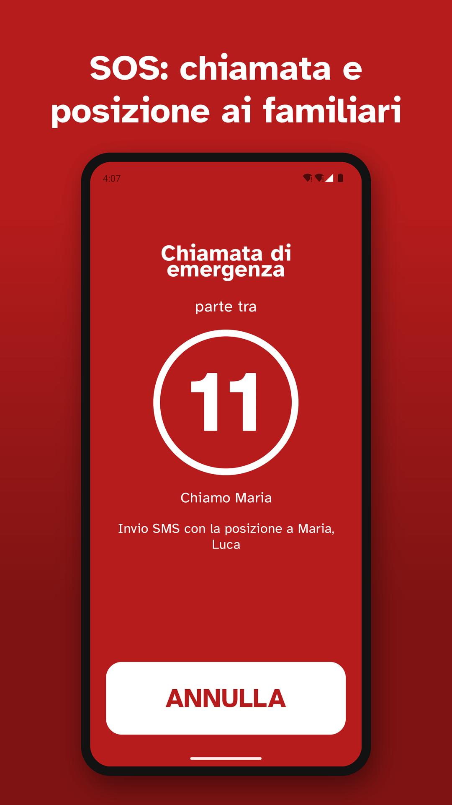
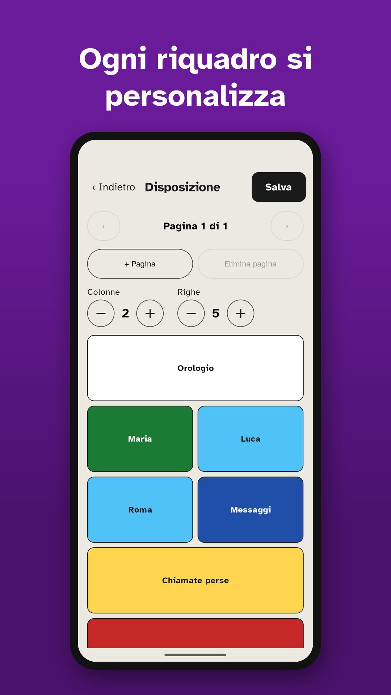
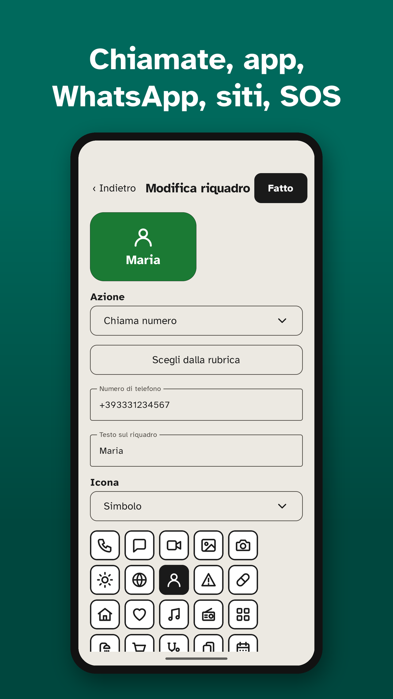
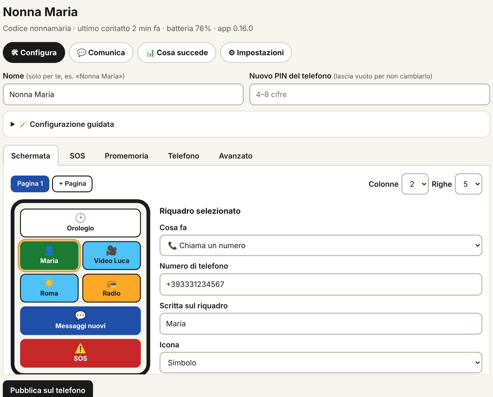

# SemplicePhone

**Il telefono semplice per i nonni.** Launcher Android con pochi riquadri grandi, SOS, promemoria
e una pagina web da cui la famiglia sistema tutto da lontano. Gratis, senza pubblicità, software libero.

[](../../releases/latest)
[](../../actions/workflows/build.yml)
[](LICENSE)


*[English version](README.en.md)*

<p align="center">
  
  
  
</p>

**[⬇ Scarica l'APK](../../releases/latest/download/SemplicePhone.apk)** · [Come si installa](#scarica-e-installa) · [Portale per la famiglia](#per-la-famiglia-il-portale) · [Privacy](PRIVACY.md)

## Per chi lo usa

- **Pochi riquadri grandi e chiari.** Ogni riquadro fa una cosa sola: chiama Maria, apre WhatsApp,
  manda un SMS, apre un sito. Scritte grandi, colori forti e un carattere molto leggibile.
- **SOS.** Basta tenerlo premuto: parte un conto alla rovescia annullabile, poi la chiamata al
  primo familiare e un SMS con la posizione a tutti.
- **Promemoria per farmaci e attività** (medicina, doccia, spesa, visita, partita a carte…):
  allarme a tutto schermo anche a telefono bloccato, con foto della pastiglia. Suona finché
  qualcuno non preme «PRESO» o «FATTO».
- **Chiamate perse.** Il riquadro mostra chi ha chiamato e non è stato richiamato: un tocco sul
  nome e si richiama.
- **Non ci si perde.** Un pulsante «CASA» resta visibile dentro le altre app: un tocco e si torna qui.
  Ogni app si apre dalla sua schermata iniziale, non dall'ultima pagina lasciata a metà.
- **Cerca app.** Un riquadro apre la ricerca dentro il launcher: si scrive o si dice una parte del
  nome (anche le iniziali, «gm» per Google Maps) e un tocco apre l'app.
- **Voce.** Una pressione lunga legge il riquadro ad alta voce, o l'ora sull'orologio. Prima di
  chiamare il telefono dice «Chiamo Maria».
- **Meteo, foto di famiglia e orologio da comodino** quando il telefono è in carica.
- **Chiamate più sicure.** I numeri sconosciuti si possono bloccare: passano solo rubrica e
  familiari. Vivavoce automatico.

<p align="center">
  
  
  
</p>

## Per la famiglia: il portale

Un file PHP da mettere sul proprio spazio web ([`tools/remote-server`](tools/remote-server)).
Da lì si sistemano i riquadri, l'SOS e i promemoria con un editor visuale, e si pubblica sul
telefono. Le modifiche sono firmate: il telefono accetta solo quelle del proprio portale.

<p align="center"></p>

- **Avvisi** su Telegram o email: SOS con posizione, promemoria non confermato, batteria scarica,
  telefono che non si fa sentire, chiamate bloccate.
- **«Dov'è?»**: posizione del telefono su richiesta, solo se consentito sul telefono.
- **Riepilogo settimanale** ogni lunedì e scheda «Ultimi 7 giorni» per ogni telefono.
- **Vede anche le modifiche fatte sul telefono** (foto comprese) e segnala i permessi che mancano.
- **Storico delle versioni**, copia della configurazione da un telefono all'altro.

Le impostazioni si possono cambiare anche sul telefono: 5 tocchi sull'orologio e PIN.

## Scarica e installa

### Quale edizione

| | **Standard** | **Completa** |
|---|---|---|
| Download | [SemplicePhone.apk](../../releases/latest/download/SemplicePhone.apk) | [SemplicePhone-completo.apk](../../releases/latest/download/SemplicePhone-completo.apk) |
| Si installa | dal browser del telefono | con ADB da computer |
| Home, SOS, promemoria, suoneria, batteria, remoto | ✅ | ✅ |
| Pallini con messaggi non letti | — | ✅ |
| Comando SMS «#AGGIORNA» | — | ✅ |
| Aggiornamento automatico (silenzioso con Device Owner) | scarica dal browser | ✅ |

La Completa usa tre permessi (ricezione SMS, lettura notifiche, installazione di APK) che
Google Play Protect blocca sulle app scaricate da internet. Per questo si installa con ADB.
Le due edizioni sono firmate con la stessa chiave: si passa dall'una all'altra installando
sopra, senza perdere le impostazioni.

### Edizione standard, passo per passo

1. Dal telefono apri il link **SemplicePhone.apk** e conferma il download.
2. **«Installare app sconosciute?»**: consenti al browser di installare app. Si fa una volta.
3. **«Analisi dell'app consigliata»** (Play Protect): premi **Analizza l'app**. Compare a ogni
   nuova versione, finché Google non conosce quel file.
4. Se compare **«App dannosa bloccata»**, è un falso positivo dovuto ai permessi dell'SOS
   (SMS, posizione, chiamate). Premi **Installa comunque**. Il codice sorgente è qui, verificabile.
5. Apri SemplicePhone e tocca il banner «usa SemplicePhone come schermata Home».
6. Tocca **5 volte l'orologio** (o lo sfondo della griglia) e scegli il PIN.
7. Configura riquadri, numeri SOS e promemoria, poi premi **Salva**. Vengono chiesti solo i
   permessi che servono.

### «Per la tua sicurezza, questa impostazione non è disponibile»

Sono le *impostazioni con restrizioni* di Android. Valgono per le app installate da un file
scaricato:
- da Android 13 bloccano l'accesso alle notifiche;
- da Android 15 anche i permessi **SMS**, cioè l'SMS dell'SOS e l'avviso batteria.

Come sbloccarle:
1. prova una volta a concedere il permesso, così compare l'opzione;
2. vai in **Info app** di SemplicePhone (nell'editor c'è il pulsante «Apri Info app»), tocca **⋮**
   in alto a destra e scegli **Consenti impostazioni con restrizioni**;
3. torna nell'editor e premi «Concedi permessi».

Su alcuni telefoni (OnePlus, Oppo, Realme con OxygenOS/ColorOS recenti) il menu ⋮ non c'è.
Allora, da computer:

```
adb shell appops set app.semplicephone ACCESS_RESTRICTED_SETTINGS allow
```

Finché il permesso SMS resta bloccato l'SOS funziona lo stesso: parte la chiamata e lo schermo
mostra **«MANDA LA POSIZIONE»**, che apre Messaggi con destinatari, testo e posizione già pronti.
L'avviso al portale (Telegram/email) parte comunque via internet.

### Edizione completa (ADB)

1. Sul telefono attiva **Opzioni sviluppatore → Debug USB**.
2. Collega il telefono al computer e accetta l'impronta. Poi:

```
adb install -r SemplicePhone-completo.apk
adb shell appops set app.semplicephone ACCESS_RESTRICTED_SETTINGS allow
```

Gli aggiornamenti successivi li installa l'app stessa (Gestione da remoto → Controlla
aggiornamenti), in silenzio se è Device Owner.

### Store

| | Edizione | Stato | Guida |
|---|---|---|---|
| **F-Droid** | completa, stesso APK firmato da noi (build riproducibile verificata) | in attesa: F-Droid accetta app con almeno 3 mesi di vita, si ripropone da febbraio 2027 | [`tools/fdroid`](tools/fdroid) |
| **Google Play** | play: come la standard, ma senza invio automatico di SMS (l'SOS apre Messaggi già pronto) | da pubblicare | [`tools/play`](tools/play) |

Tutte le edizioni hanno lo stesso pacchetto e la stessa chiave: si passa dall'una all'altra
installando sopra. Se l'app arriva da uno store, l'aggiornamento in-app si spegne e aggiorna lo
store.

### Dal 2027

Google estenderà all'Italia l'obbligo di installare app da sviluppatori verificati,
registrati nell'Android Developer Console. Prima di allora il progetto andrà registrato, oppure
si dovrà usare la procedura avanzata di Android o ADB.

### Protezione avanzata (facoltativa, Device Owner)

Su un telefono appena ripristinato e senza account aggiunti:

```
adb shell dpm set-device-owner app.semplicephone/.admin.AdminReceiver
```

Così si sbloccano:
- **Blocchi**: Home fissa, tendina bloccata, niente installazioni o disinstallazioni, niente
  ripristino di fabbrica.
- **Permessi** concessi in automatico (non l'accesso alle notifiche).
- **Aggiornamenti** dell'app silenziosi, solo nell'edizione completa.

Ogni opzione si toglie da Impostazioni › Protezione, compreso il ruolo di Device Owner.

## Lingue e privacy

- App e portale in italiano, inglese, tedesco, francese e spagnolo. L'app segue la lingua del
  telefono; da Android 13 se ne può scegliere una solo per SemplicePhone. Per tradurre:
  [TRANSLATING.md](TRANSLATING.md).
- Nessun account, nessuna statistica, nessun dato allo sviluppatore. Con la gestione da remoto i
  dati vanno solo al portale del familiare: [PRIVACY.md](PRIVACY.md).

## Per sviluppatori

Kotlin + Jetpack Compose, minSdk 29 / targetSdk 36, font Atkinson Hyperlegible (OFL). Config JSON:
`assets/default_config.json` (predefinita) → `filesDir/config.json` (locale) → config remota
firmata Ed25519 (sostituisce quella locale quando arriva una versione più nuova).

| | |
|---|---|
| **Home** | griglia per pagine (1–4 colonne × 1–8 righe), tile w×h, swipe tra pagine, tasto Home → pagina 1 |
| **Tile** | `app` (package o ruoli `@dialer @sms @camera @gallery @browser`), `call`, `wa_video`, `sms`, `url`, `shortcut`, `clock`, `sos`, `weather`, `photos`, `missed_calls`, `search` |
| **Contatti** | scelta dalla rubrica, foto in cerchio (o iniziali) oppure a tutto riquadro, chiamata diretta con `CALL_PHONE` |
| **App dall'inizio** | toccando un riquadro l'app riparte dalla sua schermata iniziale (elenco chat, messaggi…), non dall'ultima pagina vista; si sceglie per tutto il telefono e per singolo riquadro |
| **SOS** | pressione prolungata → conto alla rovescia annullabile → SMS con posizione a tutti i numeri → chiamata al primo |
| **Pallini** | chiamate perse e messaggi non letti sui riquadri delle app (accesso alle notifiche) |
| **Suoneria protetta** | silenzioso e volume basso tornano al livello scelto, anche per le sveglie |
| **Batteria** | avviso in Home e SMS ai numeri SOS sotto soglia, una volta per scarica |
| **Promemoria** | farmaci e attività (doccia, spesa, visita, carte…), ricorrenti o in una sola data, con simbolo e foto; allarme a schermo intero anche a telefono bloccato, «PRESO»/«FATTO» / rinvio, ripetizione fino a conferma, registro esiti |
| **Chiamate** | blocco dei numeri sconosciuti (filtro chiamate di sistema: passano rubrica, SOS e riquadri), vivavoce e volume massimo automatici |
| **Voce** | pressione lunga: il riquadro viene letto ad alta voce; conferma vocale prima di chiamare o aprire («Chiamo Maria») |
| **Meteo e foto** | riquadro meteo (Open-Meteo, senza account) e riquadro con le foto di famiglia che scorrono, scelte sul telefono o caricate dal portale |
| **Comodino** | in carica: orologio grande a luminosità bassa dopo un minuto senza tocchi |
| **Chiamate perse** | riquadro con chi ha chiamato e non è stato richiamato (ultimi 3 giorni), richiamata in un tocco; nell'edizione Play apre il registro chiamate |
| **Pulsante «Casa»** | sopra le altre app (permesso «Mostra sopra altre app»): un tocco torna alla Home; si sposta trascinandolo, si nasconde durante le chiamate; si può escludere per singoli riquadri (giochi, app a tutto schermo) |
| **Editor** | protetto da PIN (PBKDF2, blocco dopo 5 errori); bozza applicata solo dopo validazione; riquadri trascinabili; scorciatoie guidate; esporta/importa su file |
| **Remoto** | busta firmata Ed25519, anti-replay, PIN impostabile, controllo ogni 15 min (ETag), SMS «#AGGIORNA», eventi urgenti, «Dov'è?» (posizione su richiesta, con consenso sul telefono); portale con editor visuale (vede anche le modifiche fatte sul telefono, foto comprese), avvisi Telegram/email, riepilogo settimanale, avviso dei permessi mancanti sul telefono, storico versioni: [`tools/remote-server`](tools/remote-server) |
| **Aggiornamenti** | `update.json` + verifica SHA-256 + PackageInstaller |

### Build

- Ogni push su `main` esegue la CI: APK debug come artifact, unit test e build release R8 di controllo.
- Checklist completa di ogni release (GitHub, portale, F-Droid, Play, documentazione): [RELEASING.md](RELEASING.md).
- Release firmata: la chiave e i secrets GitHub si creano una volta con
  [`tools/release/new-keystore.ps1`](tools/release/new-keystore.ps1). Poi, a ogni versione:
  1. in `app/build.gradle.kts` aggiorna `versionName` e porta `versionCode` a +10;
  2. aggiungi `fastlane/metadata/android/*/changelogs/<versionCode>.txt`;
  3. avvia il workflow **release** con la stessa versione.

  La GitHub Release conterrà gli APK firmati, l'AAB per Play, gli `update.json` e `index.php`.
  Il workflow verifica anche che la build sia riproducibile.
- In locale: `./gradlew assembleStandardDebug testStandardDebugUnitTest` (JDK 21, Android SDK 36).

Valori di default sovrascrivibili con `-P` o in `gradle.properties`: `semplice.remoteUrl`,
`semplice.remotePubkey`, `semplice.updateUrl`.

### Modello dei riquadri

```json
{ "id": "t1", "col": 0, "row": 1, "w": 2, "h": 1,
  "type": "app | call | wa_video | sms | url | shortcut | clock | sos | weather | photos | missed_calls | search",
  "target": "package | @ruolo | numero | https://… | pacchetto/shortcutId",
  "label": "Telefono",
  "icon": { "kind": "auto | app | symbol | photo | none", "ref": "phone | contact:<lookupKey>" },
  "color": "#1F4FA8", "body": "testo SMS" }
```

Una config con tile fuori griglia, sovrapposti, id duplicati o orari non validi viene scartata
e resta in uso l'ultima valida. L'app, il server PHP e gli unit test applicano la stessa
validazione.

### Milestone

| | Stato |
|---|---|
| M0 – scheletro, ruolo HOME, CI | ✅ |
| M1 – home a tile da config, orologio, editor tile con PIN | ✅ |
| M2 – contatti con foto, chiamata diretta, video WhatsApp | ✅ |
| M3 – blocco modifiche, Device Owner | ✅ |
| M4 – SOS con countdown, SMS con posizione | ✅ |
| M5 – promemoria farmaci | ✅ |
| M6 – config remota firmata Ed25519 + server PHP | ✅ |
| M7 – release firmata, aggiornamento in-app | ✅ |
| M8 – edizioni per F-Droid (build riproducibile) e Google Play | 🔧 |
| M9 – app e portale in 5 lingue, pronti per Weblate | ✅ |
| M10 – promemoria per attività, filtro chiamate, voce, meteo, foto, comodino, «Dov'è?» | ✅ |
| M11 – chiamate perse, pulsante «Casa», riepilogo settimanale | ✅ |
| M12 – riquadro «Cerca app» (anche a voce) | ✅ |

### Limiti noti

- **Videochiamata WhatsApp**: usa la data row del contatto, che non è documentata da WhatsApp.
  Se manca apre la chat.
- **Tendina e impostazioni di sistema**: bloccabili solo con Device Owner.
- **Pallini**: richiedono l'«Accesso alle notifiche», da concedere a mano (nemmeno il Device Owner può concederlo da solo).
- **Controllo ogni 15 minuti**: è il minimo consentito da Android; in risparmio energetico profondo (Doze) può slittare. Per applicare subito: «Aggiorna ora» o SMS «#AGGIORNA».

## Licenza

Software libero e gratuito, Copyright (C) 2026 Francesco Sorzini:
- **App Android**: [GPL-3.0-or-later](LICENSE).
- **Portale** (`tools/remote-server`): [AGPL-3.0-or-later](tools/remote-server/LICENSE).

Chi lo modifica e lo ridistribuisce, o offre il portale ad altri via rete, deve pubblicare il
codice sorgente con la stessa licenza. Componenti di terze parti e avvertenze in
[`NOTICE.md`](NOTICE.md). Il pulsante SOS contatta i numeri impostati e non sostituisce il 112.
